# Atlas

**Per-trial pre-screening for clinical trials.**

A doctor at any hospital, or the patient on their own, answers one trial's criteria as plain-language questions. The hospital's research team gets a criteria map that quotes every source, confirms the referral-ready patients, and sends them to a contracted trial site as a lead pack.

Built at the **Crossroads AI Hackathon** (Sofia, October 2026). Repository name: `prescreen`. Product name: **Atlas**.

| | |
|---|---|
| Live app | https://prescreen-tau.vercel.app |
| Demo pre-screen (public page) | https://prescreen-tau.vercel.app/s/nct06380751-md2jhsjd |
| Find a trial (demo search) | https://prescreen-tau.vercel.app/find?condition=breast+cancer&markers=&city=Plovdiv |
| Pricing | https://prescreen-tau.vercel.app/pricing |
| Deployed commit | https://prescreen-tau.vercel.app/api/health |

> Every patient in this repository and in the demo is fictional. Atlas never stores real records or real contact details.

---

## Contents

- [The problem](#the-problem)
- [Who does what](#who-does-what)
- [How it works](#how-it-works)
- [Product rules](#product-rules)
- [Architecture](#architecture)
- [Tech stack](#tech-stack)
- [Getting started](#getting-started)
- [Scripts](#scripts)
- [Tests](#tests)
- [Deployment](#deployment)
- [Team workflow](#team-workflow)
- [Known limitations](#known-limitations)
- [Team](#team)

---

## The problem

**Trials run through a dozen hospitals. Patients are everywhere else.**

A research organisation (CRO) runs each trial through a fixed list of contracted trial sites, mostly big-city hospitals. Patients treated anywhere else are never screened for that trial.

Atlas lets the hospital a patient already goes to pre-screen them against one trial's criteria and refer them, consented and referral-ready, to a contracted trial site. CROs get patients their site network never sees.

## Who does what

| Role | What they do in Atlas | What they pay |
|------|-----------------------|---------------|
| **CRO** (research organisation) | Receives pre-screened, consented leads from hospitals outside its site network | A fee per pre-screened lead delivered plus a success fee when the patient enrols, or the trial plan (€990 per trial per month). The first 10 leads per trial are free. |
| **Referring hospital** | Its research team publishes the pre-screen, reads the hospital inbox and confirms the rows to refer | Nothing. Earns a share of every fee. Trial setup is free. |
| **Patient** | Answers the questions, alone or with their doctor | Free |
| **Contracted trial site** | Its research team receives the lead pack and decides who joins the trial | |

Atlas says nothing about travel, reimbursement, scheduling or the screening visit. That stays with the trial site.

## How it works

```mermaid
flowchart LR
    A["Research team pastes an NCT ID"] --> B["Study fetched from ClinicalTrials.gov"]
    B --> C["Criteria split and plain questions written, every step checked in code"]
    C --> D["Research team reviews and publishes"]
    D --> E["Public pre-screen page"]
    E --> F["Patient answers and gives consent"]
    F --> G["Criteria map: one state per criterion, every line quoted"]
    G --> H["Hospital inbox"]
    H --> I["Coordinator confirms referral-ready rows"]
    I --> J["Lead pack PDF for the trial site"]
```



### The four doors

| Door | Route | Who | What it does |
|------|-------|-----|--------------|
| Find a trial | `/find` | public | Search by condition, stage or markers and city. Shows up to 5 recruiting studies in Bulgaria from ClinicalTrials.gov, published pre-screens first, each with its recruiting sites and plain-word lines for the top criteria. |
| Public pre-screen | `/s/[slug]` | public | The questions in screens of four, then a contact screen with a required consent box (English and Bulgarian). After submitting, the patient only sees "Thank you. The research team will contact you." No result is ever shown to the submitter. |
| Hospital inbox | `/site/inbox` | research team | One row per submission with its four counts, the referral-ready label and the "Confirmed by coordinator" checkbox. Filters by trial, search text and readiness. Opens the criteria map per submission and builds the lead pack. |
| New trial | `/site/trials/new` | research team | Paste an NCT ID, "Fetch and generate", review every criterion with its quote and the questions, then Publish. A printable kit (checklist, questionnaire, referral sheet) lives at `/site/trials/[id]/kit`. |

Everything under `/site` sits behind a passcode (httpOnly cookie for 30 days, 5 wrong attempts per 10 minutes per address).

### The four states

Every criterion of a trial ends up in exactly one of four states:

| State | When |
|-------|------|
| **met** | The patient's answer confirms the criterion's text (inclusion) or denies it (exclusion) |
| **not met** | The patient's answer contradicts the criterion |
| **not found** | No question asks it, or the answer is blank or "Not sure". Missing information is never guessed. |
| **needs a clinician** | A patient cannot settle it: labs, imaging, pathology, genetic results, a clinician's judgment, a permission, a half-life window |

The state is computed **in code** from the question's rules (`lib/mapping.ts`). For free-text answers the model returns a state and a quote, and the quote must be a verbatim substring of the answer, otherwise the state is "not found". Flipping the meaning for exclusion criteria is always done by code, never by the model.

### How the questions are generated

`generateForTrial` in `lib/generate.ts` runs these steps in order. The model is `gpt-4o` at temperature 0 with strict JSON schema output. The core idea: **the model proposes, code checks**. Nothing the model writes is stored without passing the checks.

1. **Criteria split** (model): one item per bullet or numbered line, quoted verbatim, marked `askable` when a patient answer could settle it. Items that fail the checks are re-asked once, then dropped and reported.
2. **Permission guard** (`lib/must-ask.ts`): a criterion that only gives permission ("may have received", "is allowed") goes to the research team.
3. **Half-life guard** (`lib/rule-guard.ts`): a time window measured in half-lives goes to the research team, because a patient cannot know a half-life.
4. **Must-ask table** (`lib/must-ask.ts`): facts a patient always knows (age, sex, menopause, pregnancy or breastfeeding, other cancers, current medicines, prior treatment, ability to attend visits) get a fixed plain question and a rule written in code. These come first.
5. **Questions** (model): for the remaining askable criteria, up to 12 questions in total.
6. **Polarity and time-window guards** (`lib/rule-guard.ts`): yes/no questions must ask affirmatively, and a criterion with a time window ("within 6 months") must be served by a number question that asks for the number. A refused rule gets its criterion re-asked once on its own; if it fails again, the criterion goes to the research team.
7. **Generation summary** on the New trial screen: how many criteria a patient can answer, how many went to the research team and why, which rules were refused, plus model calls and tokens.

### Referral-ready and the lead pack

- **Referral-ready** (`lib/referral.ts`): no criterion is "not met". "Not found" and "needs a clinician" are counted and shown but never block it. Computed in code, never stored.
- **Summary card** (`lib/summary.ts`): built from the counts only, never a percentage. Example: "Referral-ready. 12 of 19 patient-answerable criteria met, 0 contradicted, 7 to confirm at the trial site. 15 criteria are for the research team."
- **Lead pack** (`lib/pack.ts`, pdf-lib): a patient goes in only when referral-ready, confirmed by a coordinator and with consent recorded. One A4 page per patient with the full criteria map, every criterion and answer quoted. Download only, nothing is sent.

## Product rules

These rules shape every file in the repo. The full list is in [`CLAUDE.md`](CLAUDE.md).

1. **Exactly four states per criterion**: `met`, `not_met`, `not_found`, `needs_clinician`. `components/StateCell.tsx` is the only component that renders a state.
2. **No verdicts.** Atlas never says whether a patient can join a trial as a whole, and never shows a percentage or a rating. The banned words live in `lib/wording.ts`, and `tests/ui.wording.test.ts` scans every file in the repo (this README included) and fails on them. The inbox footer says it plainly:
   > A criteria map, not an eligibility decision. Every line quotes its source.
3. **Every line cites its source**: the quoted criterion and the quoted answer. Missing means "not found", never guessed.
4. **Fictional patients only**, in seed data, fixtures and tests. Placeholder phones like `+359 00 000 0000`.
5. **Consent is required.** Checked in the UI, in the API route and in the database policy.
6. **No em dashes** in any copy, code, comment or doc. The same wording test enforces it.
7. **Words in the UI**: hospital, research team and hospital inbox. "Trial site" only for the place a patient is referred to. A lead is "pre-screened".

## Architecture

### Layers

```
Browser
  │
  ├─ Public pages (/, /find, /pricing, /s/[slug])
  └─ Research team pages (/site/...)  ← middleware.ts passcode gate
        │
        ▼
API routes (app/api/...)            ← the only way to change data
        │
        ▼
Domain logic (lib/)                 ← generation, guards, mapping, referral, pack
   │            │              │
   ▼            ▼              ▼
Supabase     OpenAI         ClinicalTrials.gov
(Postgres)   (gpt-4o)       (API v2, read only)
```

- **Pages** (`app/`) render the screens. Interactive parts (forms, filters, checkboxes) are client components in `components/`.
- **API routes** (`app/api/`) are the only entry points that read or write data. The project uses API routes instead of Server Actions because Next 14 is past its patch line.
- **Domain logic** (`lib/`) holds all the rules as plain, testable functions. The OpenAI client is passed in as a function type (`LlmJson` in `lib/openai.ts`), so tests give it a fake model and never spend tokens.
- **Database**: Supabase Postgres with Row Level Security on every table. The service role key is used only on the server (`lib/supabase.ts` imports `server-only`, so a client component cannot import it by accident).

### Security in layers

| Layer | What it protects |
|-------|------------------|
| `lib/env-guard.ts` + `instrumentation.ts` | The server refuses to start unless the Supabase URL and keys all point at the one expected project (`EXPECTED_SUPABASE_REF`) |
| `middleware.ts` + a session check in each page and route | Everything under `/site` and `/api/site` needs the passcode cookie. Checked twice, so one mistake does not open a page. |
| Row Level Security (`supabase/migrations`) | The public (anon) role may only INSERT into `submissions`, only for a published trial, only with consent, and can read nothing. `npm run db:verify-rls` checks it. |
| Rate limits (`lib/rate-limit.ts`) | Passcode: 5 wrong attempts per 10 minutes per address. Public submit: 10 per 10 minutes per address per trial. Addresses are stored as keyed hashes. |
| Public API response | `/api/s/[slug]/submit` returns only `{ ok: true }`. The public page receives only each question's id, text, type and options, never the rules. |

### Project structure

```
app/
  page.tsx                 Landing page
  find/                    Find a trial
  pricing/                 Pricing (figures in prices.ts)
  s/[slug]/                Public pre-screen page
  site/                    Research team area: passcode, inbox, new trial, printable kit
  api/                     API routes (health, login, trials, publish, submissions, pack, public submit)
components/                React components; kit/ holds the printable kit
lib/                       Domain logic, no UI
  ctgov.ts                 ClinicalTrials.gov API v2 client
  generate.ts              The generation pipeline
  must-ask.ts              Must-ask table and permission guard
  rule-guard.ts            Polarity, time-window and half-life guards
  mapping.ts               Answers to criterion states
  referral.ts, summary.ts  Referral-ready flag and summary card
  pack.ts                  Lead pack PDF
  wording.ts               Banned words and the two allowed footer sentences
  env-guard.ts             Supabase project pin
supabase/migrations/       SQL migrations 0001 to 0003
scripts/                   env check, migrate, RLS check, demo consent
tests/                     Vitest tests and ClinicalTrials.gov fixtures
docs/
  handoff.md               Full product and technical handoff
  design-system/           Vendored design system (tokens, components, fonts)
public/                    Fonts (Geologica, Overpass Mono) and icons
```

### Data model

| Table | Holds |
|-------|-------|
| `trials` | NCT ID, title, verbatim criteria text, split `criteria`, `questions` with their rules, public `slug`, `published_at`, study `source` (no contacts), `generation` report |
| `submissions` | Answers, contact, consent (`consent_given`, `consent_at`), coordinator confirmation (`confirmed_by_coordinator`, `confirmed_at`) |
| `mappings` | One row per criterion per submission: state, quoted criterion, quoted answer, question id |
| `login_attempts`, `submit_attempts` | Rate limits (hashed addresses) |
| `finder_rewrites` | Cached plain-word lines for `/find`, per NCT ID |

## Tech stack

| Part | Choice |
|------|--------|
| Framework | Next.js 14 (App Router), React 18, TypeScript |
| Styling | Tailwind CSS v3 with semantic tokens from the design system |
| Database | Supabase (Postgres, Row Level Security) |
| Model | OpenAI `gpt-4o`, temperature 0, strict JSON schema, called with `fetch` |
| Trial data | ClinicalTrials.gov API v2 |
| PDF | pdf-lib with fontkit, Geologica fonts |
| Tests | Vitest |
| Hosting | Vercel (region `dub1`) |

## Getting started

### 1. Prerequisites

- **Node.js 22.18 or newer** (the scripts in `scripts/` import TypeScript files directly)
- A **Supabase** project
- An **OpenAI API key**

### 2. Install

```bash
git clone https://github.com/hidenmonstervillage-creator/prescreen.git
cd prescreen
npm install
```

### 3. Environment variables

Copy the example file and fill it in. Never commit `.env.local`.

```bash
cp .env.example .env.local
```

| Variable | What it is |
|----------|-----------|
| `NEXT_PUBLIC_SUPABASE_URL` | `https://<ref>.supabase.co` |
| `SUPABASE_SERVICE_ROLE_KEY` | Service role key, server side only |
| `SUPABASE_ANON_KEY` | Anon (public) key |
| `SUPABASE_DB_URL` | Postgres connection string, used by the migration scripts |
| `EXPECTED_SUPABASE_REF` | The 20-letter project ref the app is pinned to |
| `SITE_PASSCODE` | Passcode for the research team area at `/site` |
| `OPENAI_VISION_MODEL` | `gpt-4o` in the example file. The app code does not read it yet (the model is set in `lib/openai.ts`). |
| `HOSPITAL_NAME` | Optional. The referring hospital named on the lead pack. Unset shows "[Hospital name]". |

**`OPENAI_API_KEY` does not go in `.env.local`.** Set it in your shell or system environment instead. `npm run env:check` refuses to pass if it finds the key in the file.

```powershell
# Windows (PowerShell), for the current session
$env:OPENAI_API_KEY = "sk-..."
```

```bash
# macOS / Linux
export OPENAI_API_KEY="sk-..."
```

Then check everything (it prints variable names and set/missing only, never values):

```bash
npm run env:check -- --derive-ref   # fills EXPECTED_SUPABASE_REF from the Supabase URL
npm run env:check
```

### 4. Database

Run these against **your own** Supabase project:

```bash
npm run db:migrate       # applies supabase/migrations
npm run db:verify-rls    # checks the anon role can only insert submissions
```

### 5. Run

```bash
npm run dev
```

Open http://localhost:3000. Sign in at `/site` with your `SITE_PASSCODE`, go to **New trial**, paste an NCT ID (for example `NCT06380751`) and publish.

## Scripts

| Command | What it does |
|---------|--------------|
| `npm run dev` | Local dev server |
| `npm run build` / `npm start` | Production build / serve it |
| `npm test` | All Vitest tests, including the wording test |
| `npm run typecheck` | `tsc --noEmit` |
| `npm run lint` | Next.js ESLint |
| `npm run env:check` | Which `.env.local` keys are set, then the env guard |
| `npm run db:migrate` | Applies `supabase/migrations` over `SUPABASE_DB_URL` |
| `npm run db:verify-rls` | Checks the Row Level Security policies |
| `npm run db:demo-consent` | Records consent on the fictional demo rows |

## Tests

```bash
npm test
```

241 tests pass, 4 are skipped. The skipped ones call the real ClinicalTrials.gov API and the real model; run them with `LIVE=1 npm test` (needs `OPENAI_API_KEY` and network).

Tests worth knowing about:

| Test | Checks |
|------|--------|
| `ui.wording.test.ts` | No banned verdict words and no em dashes in any file in the repo |
| `copy.render.test.tsx` | The rendered screens use the right role words |
| `must-ask.test.ts` | Every must-ask phrasing, plus real age criteria from ClinicalTrials.gov |
| `rule-guard.test.tsx` | Polarity, time-window and half-life guards |
| `mapping.test.ts` | Answers to states, including the exclusion flip |
| `matrix.render.test.tsx` | Renders a full criteria map from a fixture, no database needed |
| `pack.test.ts` | The lead pack PDF |
| `submit.rate-limit.test.ts` | The public submit rate limit |

## Deployment

The Vercel project `prescreen` deploys from the CLI (no Git link), from `main` only:

```bash
git rev-parse --short HEAD
vercel --prod --build-env BUILD_COMMIT=<hash>
```

Then open `/api/health`: it returns `{ "ok": true, "commit": "<hash>" }`, so you can see exactly which commit is live. API routes run in `dub1` with `maxDuration` 300 seconds, because generating a long trial can take about a minute.

## Team workflow

- **`main`**: backend, generation, database and deploys (Mike).
- **`ui/<topic>`** branches: the UI layer only, meaning `app/` pages and layouts, `components/`, styles and `tailwind.config.ts`. Not `app/api/`, `lib/`, `supabase/` or `scripts/`. UI branches never deploy and never run migrations or seeds; Mike merges and deploys.
- **Keep the `data-*` hooks** when restyling (`data-nct-input`, `data-publish`, `data-criterion-id`, `data-state`, `data-submit`, `data-confirm` and the rest). Tests and checks find elements by them. The full list is in `CLAUDE.md` rule 9 and `docs/handoff.md`.
- **Design system**: `docs/design-system/` (vendored, edits listed in `VENDORED.md`). Shared class recipes are in `components/ui.ts`. Red, green and amber belong to the four criterion states only. One primary button per view.
- **Every change ends with** `npm test`, `npx tsc --noEmit`, and a click check.

Read [`CLAUDE.md`](CLAUDE.md) and [`docs/handoff.md`](docs/handoff.md) before changing anything.

## Known limitations

Atlas is a hackathon prototype. Known gaps:

- The guards are regular expressions, checked on two production trials so far. They will miss or over-catch some registry wordings.
- A trial gets at most 12 questions. Askable criteria past that limit map to "not found".
- Age ranges deny on one side only: for 18 to 74, an answer of 80 gives "not met" but 16 gives "not found".
- Criteria lines with a markdown `\^` escape (such as `kg/m\^2`) are dropped by the split.
- The lead pack names the referring hospital but has no referring-doctor field yet.
- The inbox, map and pack layouts were checked in a narrow pane only, not at full desktop width or on a phone.
- Pricing amounts other than the trial plan are placeholders still to be set.

The full list is in `docs/handoff.md` under "NOT KNOWN".

**Roadmap:** requesting medical records for a full review, through Karma (a separate project). For now it is a disabled button in the hospital inbox, captioned "coming: Karma". Atlas never calls Karma's engine, database or API.

## Team

- **Mike**: backend, generation pipeline, database and deploys
- **Ivayla Chomakovska**: UI and design system

Built for the Crossroads AI Hackathon, Sofia, 2026.
